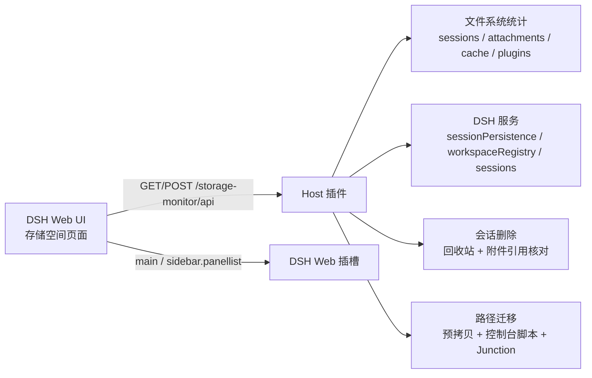

# dsh-storage-monitor

[](LICENSE)
[](https://www.npmjs.com/package/dsh-storage-monitor)
[](#requirements)
[](https://github.com/deepseek-ai)
[](https://github.com/zixiaog/dsh-storage-monitor/actions/workflows/check.yml)

DeepSeek Harness（DSH）的**存储空间监测、清理与路径迁移**插件。

它把散落在 `DSH_HOME` 里的会话日志、附件、缓存、插件包、运行时、插件数据和工作区项目
统计成一份可读的报告，用图表展示，并给出可执行的清理建议；同时支持**彻底删除会话**
（带回收站）和**把 DSH 数据目录迁移到其它磁盘并在原路径保留 Junction 映射**。

> 面向 DSH Desktop。路径迁移/窗口映射相关功能仅支持 Windows；统计与清理功能是纯 Node
> 实现，但当前插件按 DSH Desktop 的 Web UI 形态分发。

---

## 功能

- **分类统计**：会话日志、附件、缓存、存储索引、插件目录、已安装插件包、运行时、
  插件数据、日志配置、回收站，共 10 类；工作区项目文件单独统计。
- **图表展示**：分类环形图、Top 会话条形图、占用构成堆叠条、KPI 卡片。
- **清理建议**：按「安全 / 谨慎 / 不要动」分级；缓存、回收站、孤立投影缓存、孤儿附件可一键清理。
- **会话管理**：搜索/筛选/批量删除；默认移入回收站，可恢复；永久删除需二次确认；
  删除时按引用关系只删除**仅属于该会话**的附件，共享附件保留。
- **路径迁移**：把 `DSH_HOME`（含 profile）迁到其它磁盘，原路径改成 Windows Junction；
  支持在线预拷贝、生成切换/回滚脚本，以及**一键智能迁移**：独立控制台自动关闭 DSH、
  同步、建映射、验证、删旧目录并重启 DSH。
- **迁移验证**：重启后对比迁移前快照（会话数、插件包数、目标路径、写探针）。
- **页面**：DSH Web UI 原生插槽页面，跟随主题明暗，六个模块：
  概览 / 分类 / 会话 / 建议 / 迁移 / 回收站。

> 界面截图：本仓库暂未内置截图。运行插件后可在左侧栏打开「存储空间」。

---

## 安全提示（务必阅读）

- **删除会话**默认进回收站，永久删除不可恢复；删除前请确认当前会话不在运行中。
- **路径迁移**涉及重命名 DSH 数据目录与创建 Junction。迁移控制台会在约 5 秒后关闭 DSH；
  请先保存工作，并保持控制台窗口打开，直到看到 `DONE`。
- 一键迁移不是 100% 优雅关闭：脚本先尝试关闭 DSH 窗口，超时后才强制结束宿主进程；
  不要在对话/任务正在执行时启动迁移。
- 迁移脚本默认在验证映射成功后删除旧目录以释放空间；想保留退路可勾选「保留旧目录备份」。
- 本插件不做任何网络请求，数据只留在本机；但删除/迁移属于高危操作，请自行做好备份。

---

## 环境要求

| 项目 | 要求 |
| --- | --- |
| DSH | Desktop 0.2.x（Web UI 可用） |
| 操作系统 | Windows 10/11（路径迁移依赖 NTFS Junction）；统计/清理代码本身不绑定平台 |
| Node.js | 仅开发/校验需要，>= 22.12 |
| 运行时依赖 | 无。Host 只使用 Node 内置模块与 DSH 提供的服务 |

---

## 安装

> 在**另一台电脑**上安装时，推荐方式 A（npm）或方式 B（GitHub），都不需要手动构建。

### 方式 A：从 npm 安装（推荐）

包名：**`dsh-storage-monitor`** · npm 页面：https://www.npmjs.com/package/dsh-storage-monitor

1. 打开 DSH Desktop → 左侧栏 **Plugins（插件）**页面；
2. 点安装 / Add bundle，输入 npm 包名：

   ```text
   dsh-storage-monitor
   ```

   或指定版本：

   ```text
   dsh-storage-monitor@0.1.1
   ```

3. 安装完成后启用 `dsh-storage-monitor` bundle，刷新 DSH Web 页面；
4. 左侧栏出现「存储空间」入口。

也可以直接对 DSH 的 agent 说：

```text
安装插件 bundle：dsh-storage-monitor
```

agent 会调用 `plugin_manager install_bundle`（需要 `danger-full-access` 或逐次批准）。

> 国内网络如果访问 npm 官方 registry 慢，可让 DSH/pnpm 使用镜像（例如
> `https://registry.npmmirror.com/`）；镜像同步新发布的包可能有延迟。

### 方式 B：直接从 GitHub 安装

1. 打开 DSH Desktop → **Plugins（插件）**页面；
2. 点安装 / Add bundle，选择从 **Git / URL** 安装，填入：

   ```text
   https://github.com/zixiaog/dsh-storage-monitor.git
   ```

3. 安装完成后启用 `dsh-storage-monitor` bundle，刷新 DSH Web 页面；
4. 左侧栏出现「存储空间」入口。

也可以直接对 DSH 的 agent 说：

```text
安装插件 bundle：https://github.com/zixiaog/dsh-storage-monitor.git
```

> 如果 GitHub 访问慢或超时，先在系统/终端里配置好代理再安装；也可以改用方式 C 下载 ZIP。

### 方式 C：从本地目录安装

1. 克隆或下载本仓库到本机：

   ```powershell
   git clone https://github.com/zixiaog/dsh-storage-monitor.git
   ```

   或在 GitHub 页面 **Code → Download ZIP** 后解压。

2. 在 DSH 插件页使用**从本地目录安装**，选择该目录；
   或让 agent 执行：

   ```text
   plugin_manager install_bundle  target = <本仓库绝对路径>
   ```

3. 启用 bundle，刷新 DSH Web 页面，左侧栏出现「存储空间」入口。

卸载时在插件管理页移除 bundle 即可；本插件不会写入 profile 配置，
只会在 `<DSH_HOME>/storage-monitor/` 下保留回收站与迁移脚本。

> 路径迁移/一键迁移依赖 Windows NTFS Junction，仅 Windows 支持；
> 统计、清理、会话管理功能本身是纯 Node 实现。

---

## 使用

打开 **存储空间**，顶部六个页签：

### 概览 / 分类

看总占用、可安全清理空间、分类占比与最大会话；分类页可展开每类的子项。

### 会话

搜索、按「空会话 / 90 天未用 / 已归档 / 已固定 / 运行中」筛选，批量选择后删除。
开启「深度扫描」后会读取会话日志，显示每个会话独占的附件占用。

### 建议

安全项可一键执行：清空回收站、清缓存、清孤立投影缓存、清孤儿附件。
风险项会跳转到会话筛选，由你决定。

### 回收站

恢复或永久删除已删除的会话。

### 迁移

三个子页签：

- **一键迁移**（推荐）
  1. 选择源目录（推荐「DSH 数据目录」）；
  2. 选择目标目录并校验；
  3. 选择「自动重启 DSH」「保留旧目录备份」，点击「生成并启动迁移控制台」；
  4. 独立控制台显示倒计时与进度，自动完成关闭 DSH → 同步 → 建 Junction →
     验证 →（默认）删除旧目录 → 重启 DSH；
  5. 重启后回到「映射状态」查看迁移验证。
- **手动模式**：预拷贝 → 生成脚本 → 退出 DSH 后自己运行脚本。
- **映射状态**：已映射路径的目标、回滚脚本入口与验证结果。

迁移前请确认：
- 目标目录在**另一块固定磁盘**上、为空、剩余空间 ≥ 数据量 × 1.05 + 200MB；
- 不要把目标放在移动硬盘/U 盘（盘未连接时 DSH 会打不开）；
- 迁移完成后原路径仍然是 `C:\Users\<user>\.dsh`，只是变成了 Junction。

### Agent 工具

同时注册 `storage_inspect` 工具，可让 agent 查询报告、删除会话、管理回收站、
清理缓存/孤儿附件；迁移相关操作**不暴露给 agent**。

---

## 工作原理（简版）



完整设计、数据来源、安全边界、验证记录见 [docs/DESIGN.md](docs/DESIGN.md)。

---

## 开发

无构建步骤：Host 为 ESM，Client 为 `window.__ModuleLoader__` 动态模块。
本地修改后重新安装/重载插件并刷新页面即可。

```powershell
npm test        # node scripts/check.mjs：语法、JSON、清单一致性检查
```

贡献指南、代码结构与测试清单见 [CONTRIBUTING.md](CONTRIBUTING.md)。

---

## 兼容性

- 针对 DSH `0.2.2-rc.1` 的 Web UI 与服务编写；
- 会话格式 v4（`session.v4.jsonl.zstd`）、附件 `attachments/v1`、投影缓存
  `storages/session_projcache`、工作区注册表 `storages/workspace.json`；
- DSH 升级后如果这些内部路径或服务契约变化，插件可能需要同步调整。

---

## 许可证

[MIT](LICENSE) © 2026 zixiaog
